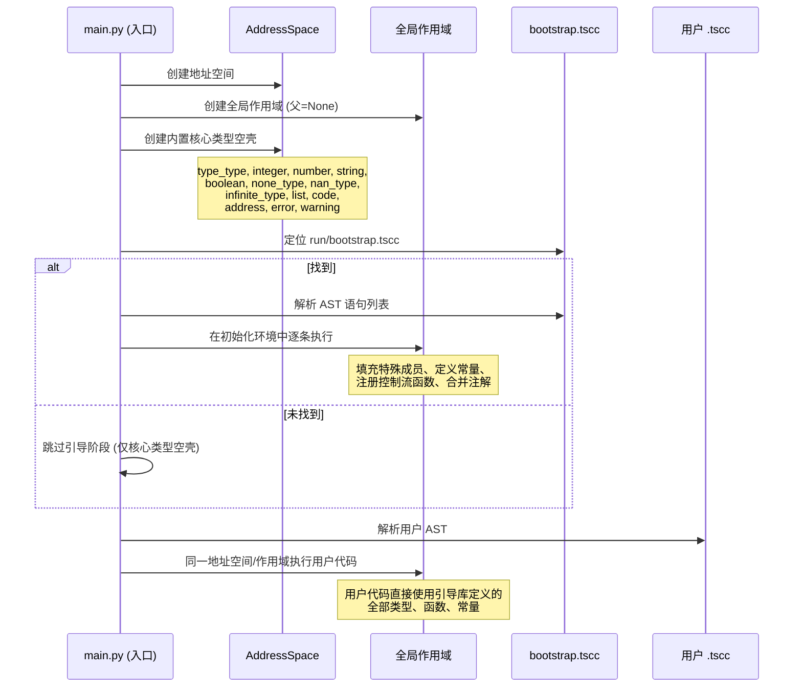

# 运行时内部机制

> 对标 [Python Execution Model](https://docs.python.org/zh-cn/3.16/reference/executionmodel.html)
>
> 面向语言实现维护者、解释器核心开发者。记录解释器启动流程、核心类型初始化细节、控制流信号机制、模块加载器内部实现。

---

## 1. 启动流程总览

### 1.1 时序图



### 1.2 详细步骤

| 步骤 | 动作 | 关键点 |
|------|------|--------|
| 1 | 建立地址空间 | `AddressSpace()`，地址从 0 开始单调递增 |
| 2 | 建立全局作用域 | `Scope(parent=None)`，顶层作用域 |
| 3 | 创建核心类型空壳 | 见 [2. 核心类型初始化规范](#2-核心类型初始化规范) |
| 4 | 定位引导库 | 仅检查 `run/bootstrap.tscc`，**单一路径**，无则跳过 |
| 5 | 加载引导库 | 解析 JSON AST，逐语句 `eval` 执行 |
| 6 | 合并引导注解 | `bootstrap.tscc` 的 `annotations`/`annotation` 合并进解释器注解表 |
| 7 | 执行用户代码 | 同一地址空间/作用域，用户代码可见引导库所有定义 |
| 8 | 处理顶层返回 | `$ n`：`Integer` 作退出码退出，非 `Integer` 报错；正常结束退出码 0 |

### 1.3 环境共享机制

- **地址空间单例**：引导阶段与用户阶段共享同一 `AddressSpace` 实例
- **全局作用域单例**：引导阶段在全局作用域声明的所有标识符(类型、常量、函数)，用户代码直接可见，**无需 import**
- **注解表单例**：引导库注解与用户文件注解共存于同一 `AnnotationTable` (库注解隔离见 [模块系统：库注解隔离](modules.md#7-库注解隔离机制))

---

## 2. 核心类型初始化规范

> 引导库 `bootstrap.tsuc` (编译为 `bootstrap.tscc`) 在运行时最先加载，定义语言核心类型、常量、函数、特殊成员注册协议。解释器启动时先创建「空壳类型对象」，再执行引导库语句为其「填血肉」。

### 2.1 类型基：`type_type`

**创建时机**：步骤 3 最先创建。

```tanex script
# 解释器内部创建(伪代码)
* type_type = make_type()  # 内部构造，非 Type{} 语法
*** type_type.inherit = type_type;  # 自身继承自身
# 此时 type_type 为空壳：无 initialize、无特殊成员、成员字典空
```

- 存入地址空间，标记常量，全局作用域绑定 `type_type`
- 所有后续类型创建均通过 `type_type{}` 或 `type_type(...)`

### 2.2 原类型：`integer`

**创建时机**：步骤 3，紧随 `type_type` 后。

```tanex script
# 解释器内部创建
* integer_type = make_type()  # 空壳类型对象
# 标记为原类型：运行时特殊处理，值直接以整数形式存在，不包装实例
```

- **关键差异**：`Integer` 值**不分配存储单元**，不经过地址空间，解释器内部以 Python `int` 直接运算
- 全局作用域绑定 `integer` 常量指向此类型对象
- 引导库**不**为 `integer` 注册特殊成员(算术/比较直接用内置数值运算)

### 2.3 其他核心类型空壳创建

**创建时机**：步骤 3，批量创建以下类型的空实例(有类型对象但无成员、无特殊成员)：

| 标识符 | 类型对象变量 | 说明 |
|--------|-------------|------|
| `number` | `number_type` | 精确十进制数 |
| `string` | `string_type` | Unicode 字符串 |
| `boolean` | `boolean_type` | 布尔 |
| `none_type` | `none_type_type` | 空类型 |
| `nan_type` | `nan_type_type` | NaN |
| `infinite_type` | `infinite_type_type` | 无穷 |
| `list` | `list_type` | 列表/链表 |
| `code` | `code_type` | 代码块 |
| `address` | `address_type` | 地址值 |
| `error` | `error_type` | 错误 |
| `warning` | `warning_type` | 警告 |

- 全部存入地址空间、标记常量、全局作用域绑定同名标识符
- **设计理由**：引导库代码本身引用这些名字(如 `boolean{}`、`list{}`)，必须先存在「空壳」

### 2.4 引导库执行：填充核心类型

引导库 `bootstrap.tsuc` 逐语句执行，以下为各类型的关键初始化逻辑(源码级规范)。

#### Boolean 类型初始化

```tanex script
# 1. 创建布尔类型对象(已在步骤 3 创建空壳，此处填充)
# 2. 注册构造器
*** boolean.initialize = [* self, [* default, integer, `0]] => {
    self.value = default != `0 ? `1 : `0;
};

# 3. 注册布尔转换(真值判定)
*** boolean.boolean = [* self] => { $ self.value; };

# 4. 注册 7 个算术特殊成员(均返回 Integer)
*** boolean.addition = [* self, * other] => { $ self.value + other.value; };
*** boolean.subtract = [* self, * other] => { $ self.value - other.value; };
*** boolean.multiply = [* self, * other] => { $ self.value * other.value; };
*** boolean.divide = [* self, * other] => { $ self.value / other.value; };
*** boolean.exactly_divisible = [* self, * other] => { $ self.value \ other.value; };
*** boolean.modulo = [* self, * other] => { $ self.value % other.value; };
*** boolean.power = [* self, * other] => { $ power_integer(self.value, other.value); };

# 5. 定义全局常量 true/false
*** true = boolean{`1};
*** false = boolean{`0};
```

**关键点**：
- `Boolean` 算术返回 `Integer`，使布尔值可直接参与整数运算
- `true`/`false` 由引导库定义，**不属于**启动阶段空壳内容

#### NoneType 类型初始化

```tanex script
# 1. 注册布尔转换：恒假
*** none_type.boolean = [* self] => { $ false; };

# 2. 创建全局单例 none
*** none = none_type{};
```

**机制**：`none_type.boolean` 恒返回 `false`，保证 `none` 在一切条件判断中恒为假。全局仅一个 `none` 实例。

#### List 节点类型 / List 类型初始化

```tanex script
# List 节点类型(内部用)
* ListNode = type_type{};
*** ListNode.initialize = [* self, * value, [* next, none]] => {
    self.value = value;
    self.next = next;
};

# List 类型
*** list.initialize = [* self] => {
    self.head = none;
    self.tail = none;
    self.size = `0;
};

# 追加方法
*** list.append = [* self, * value] => {
    * node = ListNode{value, none};
    self.tail == none ? {
        self.head = node;
        self.tail = node;
    } : {
        self.tail.next = node;
        self.tail = node;
    };
    self.size = self.size + `1;
};

# 字符串转换：返回自身数据链表
*** list.string = [* self] => { $ self; };

# 索引方法
*** list.index = [* self, * idx] => {
    * node = self.head;
    * i = `0;
    { i < idx } $$ {
        node = node.next;
        i = i + `1;
    };
    $ node.value;
};
```

**机制**：单向链表、头尾指针、追加 O(1)、索引 O(n)。`String` 内部复用 `List` 作数据存储。

#### String 类型初始化

```tanex script
# 1. 构造器：内部创建空链表作为 data 成员
*** string.initialize = [* self] => {
    self.data = list{};
};

# 2. 追加字符
*** string.push_char = [* self, * code] => {
    self.data.append(code);
};

# 3. 字符串转换：返回内部数据链表
*** string.string = [* self] => { $ self.data; };

# 4. 索引取值
*** string.index = [* self, * idx] => {
    $ self.data.index(idx);
};
```

**机制**：`String` 持有 `List` 实例(`data` 成员)，所有字符操作委托给链表。`<<` 输出调用 `string` 特殊成员得链表，逐码点打印。

#### Number 类型初始化

```tanex script
# 1. 构造器：支持单参(Integer/Number)与双参快捷构造
*** number.initialize = [* self, * value] => {
    value.front | _ : _ : {  # 尝试取 value.front 成员
        self.front = value.front;
        self.back = value.back;
    } : {
        self.front = value;  # value 为 Integer
        self.back = `0;
    };
};

# 2. 加法(精确十进制，对齐小数位、进位)
*** number.addition = [* self, * other] => {
    # 对齐小数位数
    * d1 = digits_of(self.back);
    * d2 = digits_of(other.back);
    * max_d = max(d1, d2);
    * b1 = self.back * ten_pow(max_d - d1);
    * b2 = other.back * ten_pow(max_d - d2);
    * carry = (b1 + b2) \ ten_pow(max_d);
    * new_back = (b1 + b2) % ten_pow(max_d);
    * new_front = self.front + other.front + carry;
    $ number{new_front, new_back};
};

# 3. 字符串转换(逐位 +48 得字符码)
*** number.string = [* self] => {
    # 处理符号、整数部分、小数部分
    # 返回字符码链表
};

# 4. 辅助函数(引导库内部定义)
*** digits_of = [*n] => { n == `0 ? `0 : `1 + digits_of(n \ `10); };
*** ten_pow = [*n] => { n == `0 ? `1 : `10 * ten_pow(n - `1); };
*** max = [*a, *b] => { a > b ? a : b; };
```

**机制**：`Number` 内部 `front`(整数部分 `Integer`) + `back`(小数部分 `Integer`) + 隐含 `scale`(小数位数)。运算时对齐 `scale`、整数运算、提取进位、重组。

#### 控制流函数定义

```tanex script
# if(条件, 成立代码块, 不成立代码块)
*** if = [* cond, * then_block, * else_block] => {
    cond ? { then_block(); } : { else_block(); };
};

# for(*变量, 列表, 循环体)
*** for = [* var_decl, * iterable, * body] => {
    * idx = `0;
    { idx < iterable.size } $$ {
        * var_decl = iterable.index(idx);  # 赋值给循环变量
        body();
        idx = idx + `1;
    };
};

# while(条件代码块, 循环体代码块)
*** while = [* cond_block, * body] => {
    { cond_block(); } $$ { body(); };
};

# cycle(次数, 循环体)
*** cycle = [* times, * body] => {
    * i = `0;
    { i < times } $$ { body(); i = i + `1; };
};
```

**机制**：均为 Tanex Script 函数，依赖解释器代码块执行、`$$` 循环符、`$` 返回/收集、`break`/`contiune` 零元运算符。

#### 标准输出/输入函数

```tanex script
# 标准输出：透传处理函数
*** standard_output = [* data] => { $ data; };

# 标准输入：读取一行返回
*** standard_input = [* prompt] => {
    # 内部调用宿主环境读取 stdin
    $ read_line_from_stdin();
};
```

**机制**：`<<` 调用左操作数处理函数，默认 `standard_output` 透传字符码链表逐字符打印。可替换实现过滤/缓冲/翻译。

---

### 2.5 引导库注解表

引导库为每个核心类型、函数、常量提供标准注解。编译产物 `bootstrap.tscc` 含 `annotations` 字段，启动时合并进解释器全局注解表。

**注解示例(节选)**：

```json
{
  "annotations": {
    "type_type": "所有类型的基类型(元类型)",
    "integer": "原类型：无符号任意精度整数",
    "number": "精确十进制数类型",
    "string": "Unicode 字符串类型",
    "boolean": "布尔类型(真值存储 1，假值存储 0)",
    "none_type": "空类型，唯一值 none",
    "list": "单向链表容器类型",
    "code": "代码块类型(惰性求值)",
    "if": "条件分支函数：if(条件, 成立块, 不成立块)",
    "for": "遍历循环：for(*变量, 可遍历值, 循环体)",
    "while": "条件循环：while(条件块, 循环体)",
    "cycle": "定次循环：cycle(次数, 循环体)",
    "standard_output": "标准输出处理函数(透传字符码链表)",
    "true": "布尔真常量",
    "false": "布尔假常量",
    "none": "空值常量"
  },
  "annotation": "Tanex Script 引导标准库 v1.0.0"
}
```

- 用户文件编译产物的 `annotations` 同样合并，**用户注解覆盖同名引导注解**(最后合并者胜)
- 文件级注解 `annotation` 字段仅保留用户文件的(引导库无文件级注解或被覆盖)

---

## 3. 控制流信号机制

解释器在求值过程中使用内部信号(异常类)实现控制流，非错误。

### 3.1 信号类型

| 信号类 | 触发语法 | 捕获位置 | 行为 |
|--------|----------|----------|------|
| `BreakSignal` | `break;` | `$$` 循环 | 立即退出循环，返回已收集列表 |
| `ContinueSignal` | `contiune;` | `$$` 循环 | 结束本轮迭代，重新求值条件 |
| `ReturnSignal(value)` | `$ expr` / `return expr` | 函数调用、代码块 | 携带值提前结束，作为调用结果 |
| `ErrorSignal(value)` | `<- expr` | `|` 尝试结构 | 携带错误值，被捕获绑定到 `*err` |

### 3.2 传播规则

- 信号在求值栈中向上冒泡
- 遇到对应的处理结构(`$$`、`函数调用`、`|`)时被捕获并处理
- 无对应处理结构时到达顶层入口：
  - `BreakSignal`/`ContinueSignal`：报错“break/continue 不在循环中”
  - `ReturnSignal`：顶层 `$ n` 作退出码退出
  - `ErrorSignal`：打印错误信息，非零退出

### 3.3 `$$` 循环符内部实现

```python
def eval_loop(condition_ast, body_ast, scope, addr_space):
    collected = []
    while True:
        # 求值条件
        cond_val = eval(condition_ast, scope, addr_space)
        if not ts_truthy(cond_val):
            break
        
        # 执行循环体(捕获控制流信号)
        try:
            # 临时改写 $ 语义为收集
            with collect_mode(addr_space):
                body_val = eval(body_ast, scope, addr_space)
        except BreakSignal:
            break
        except ContinueSignal:
            continue
        except ReturnSignal as rs:
            # $$ 内 $ 为收集，不抛出 ReturnSignal
            collected.append(rs.value)
        except ErrorSignal:
            raise  # 传播给外层
    
    return make_list(collected)
```

### 3.4 多层跳出 `$` (二元) 实现

```python
def eval_multi_level_return(levels_ast, value_ast, scope, addr_space):
    levels = eval(levels_ast, scope, addr_space)
    if not isinstance(levels, TSInteger) or levels.value < 1:
        raise TSTypeError("Multi-level return depth must be positive integer")
    
    value = eval(value_ast, scope, addr_space)
    # 抛出特殊信号，携带层数和值
    raise MultiLevelReturnSignal(levels.value, value)
```

解释器在函数调用/代码块边界捕获 `MultiLevelReturnSignal`，递减层数，层数归零时作为返回值。

---

## 4. 模块加载器内部实现

### 4.1 `load_library_module` 流程

```python
def load_library_module(path_expr_ast, scope, addr_space):
    # 1. 求值路径表达式得字符串路径
    path_val = eval(path_expr_ast, scope, addr_space)
    if not isinstance(path_val, TSString):
        raise TSTypeError("Import path must be string")
    
    # 2. 解析路径 -> 绝对路径列表
    resolved_paths = resolve_import_path(path_val.value)
    
    # 3. 打开 .tscc/.tscl，解析 AST
    for rp in resolved_paths:
        if rp.type == 'tscc':
            ast_dict = parse_tscc(rp.path)
        elif rp.type == 'tscl':
            ast_dict = extract_tscl(rp.path, rp.internal_path)
        else:
            continue
        
        # 4. 在当前地址空间/作用域执行库语句
        exec_ast(ast_dict["Tanex Script"], scope, addr_space)
        
        # 5. 收集库顶层声明构建 TSLibrary
        lib_members = collect_top_level_bindings(scope)
        lib_annotations = ast_dict.get("annotations", {})
        
        return TSLibrary(lib_members, lib_annotations)
    
    raise TSImportError(f"Cannot resolve import path: {path_val.value}")
```

### 4.2 路径解析算法 `resolve_import_path`

```python
def resolve_import_path(path_str):
    candidates = []
    
    # 1. 标准库优先：裸名 "standard" 优先安装目录
    if path_str == "standard":
        candidates.append(ResolvedPath(install_dir/"run/standard.tscl", 'tscl', priority=0))
    
    # 2. 相对路径：基于当前文件目录
    if path_str.startswith("./") or path_str.startswith("../"):
        base = current_file_dir or cwd
        candidates.extend(resolve_relative(base, path_str))
    
    # 3. 绝对路径
    if is_absolute(path_str):
        candidates.append(resolve_absolute(path_str))
    
    # 4. 库搜索路径
    for lib_path in lib_paths:
        candidates.extend(resolve_relative(lib_path, path_str))
    
    # 5. 歧义消除：同名多内容报错
    if len(candidates) > 1:
        # .tscc 与同名 .tsuc 不算歧义
        # 文件夹与 .tscl 同名：裸名优先 .tscl
        # 仍有歧义则报错
        raise TSImportError(f"Ambiguous import path: {path_str}")
    
    return candidates
```

### 4.3 模块缓存 `ModuleCache`

```python
class ModuleCache:
    def __init__(self):
        self._cache = {}  # 绝对路径 -> TSLibrary
    
    def get(self, path):
        return self._cache.get(path)
    
    def put(self, path, library):
        self._cache[path] = library
    
    def invalidate(self, path):
        self._cache.pop(path, None)
    
    def clear(self):
        self._cache.clear()
```

- 解释器实例持有一个 `ModuleCache`，支持热重载(调用 `invalidate` 后重新加载)

---

## 5. 注解系统内部实现

### 5.1 `AnnotationTable` 结构

```python
class AnnotationTable:
    def __init__(self):
        self._global = {}  # 顶层注解
        self._libraries = {}  # lib_name -> {member: annotation}
    
    def merge(self, annotations, lib_name=None):
        target = self._global if lib_name is None else self._libraries.setdefault(lib_name, {})
        target.update(annotations)
    
    def get(self, key, lib_name=None):
        target = self._global if lib_name is None else self._libraries.get(lib_name, {})
        return target.get(key)
    
    def get_file_annotation(self, lib_name=None):
        # 存储在特殊键 "__file__" 或单独字段
        ...
```

### 5.2 合并策略

- 启动时：合并引导库 `annotations` → `_global`
- `import "lib" = *h`：合并库 `annotations` → `_libraries["lib"]`
- `-> "lib"`：合并库 `annotations` → `_global`(键冲突覆盖警告)
- 用户文件：合并用户 `annotations` → `_global`(用户注解覆盖引导注解)

### 5.3 `??` 运算符实现

```python
def eval_annotation_read(operand_ast, scope, addr_space, anno_table):
    # operand 必须为标识符或 lib.member 成员访问链
    if operand_ast.type == 'name':
        key = operand_ast.value
        lib_name = None
    elif operand_ast.type == 'member' and operand_ast.left.type == 'name':
        lib_name = operand_ast.left.value
        key = operand_ast.right.name.value
    else:
        raise TSTypeError("Annotation read operand must be identifier or lib.member")
    
    content = anno_table.get(key, lib_name)
    return make_string(content) if content is not None else TSNone.INSTANCE
```

---

## 6. 标准库注册机制(解释器侧)

### 6.1 内置类型注册

```python
def register_builtin_type(name, type_obj):
    addr = interpreter.address_space.allocate()
    interpreter.global_scope.declare(name, addr)
    interpreter.address_space.write(addr, type_obj)
    interpreter.address_space.mark_const(addr)
```

### 6.2 内置函数注册

```python
def register_builtin_function(name, py_callable):
    fn_val = make_function_from_python(py_callable)
    addr = interpreter.address_space.allocate()
    interpreter.global_scope.declare(name, addr)
    interpreter.address_space.write(addr, fn_val)
    interpreter.address_space.mark_const(addr)
```

### 6.3 特殊成员注册

```python
def register_special_member(type_obj, member_name, py_callable):
    fn_val = make_function_from_python(py_callable)
    type_obj.special_members[member_name] = fn_val
```

---

## 相关链接

- [语言参考：词法](lexical.md) — 注解语法
- [语言参考：表达式](expressions.md) — 控制流表达式、尝试结构
- [语言参考：模块](modules.md) — import/-> 用户层面语义
- [扩展与嵌入](../extending/) — Python API：解释器嵌入、编译器、值模型
- [专题指南：类型设计模式](../howto/type_design.md) — 自定义类型、继承与运算符重载