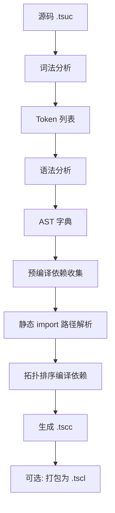

# 编译流程与产物

> Tanex Script 编译器内部流程、编译产物格式、预编译依赖解析。

---

## 1. 编译流程总览



---

## 2. 词法分析

### 2.1 输入
- UTF-8 编码源文件 (`.tsuc`)
- 按字符流处理

### 2.2 输出
- Token 列表，每个 Token 含：
  - `type`: Token 类型 (`integer`、`string`、`identifier`、`operator`、`keyword` 等)
  - `value`: 原始文本值
  - `pos`: 位置 `[line, column]` (1-based)

### 2.3 关键规则
- 注释 `#...#` 识别为单个 `comment` Token，后续忽略
- 注解 `@ ident # content #;` 识别为 `annotation` Token，含目标标识符与内容
- 字符串/数字字面量保持原始引号
- 关键字别名 (`and`/`or`/`not`/`is`) 词法阶段自动替换为对应运算符

---

## 3. 语法分析

### 3.1 算法
- Pratt 解析器 (Top-down Operator Precedence)
- 按运算符优先级构建 AST
- 表达式符号 `import`/`->` 作为 Pratt 前缀运算符，绑定优先级 `prec_assign + 1`

### 3.2 AST 节点统一字段
所有 AST 节点含 `pos: [line, column]` (1-based)。

### 3.3 主要节点类型
| 节点类型 | 说明 |
|----------|------|
| `integer`/`number`/`string`/`boolean`/`none_type`/`nan_type`/`infinite_type` | 字面量 |
| `name` | 标识符引用 |
| `unary` | 一元运算符 |
| `binary` | 二元运算符 |
| `ternary` | 三目运算符 |
| `try` | 尝试结构 |
| `assignment` | 赋值 |
| `subscript` | 下标访问 |
| `member` | 成员访问 |
| `new` | 实例创建 `Type{...}` |
| `function` | 函数调用 |
| `code` | 代码块字面量 |
| `list` | 列表字面量 |
| `break`/`contiune` | 零元运算符 |
| `import`/`include` | 导入语句 |

---

## 4. 预编译依赖收集

### 4.1 静态 import 识别
- 遍历 AST，查找 `import`/`include` 节点
- 仅处理**路径为字符串字面量**的 import (动态表达式跳过)
- 收集路径，解析为绝对路径

### 4.2 依赖图构建
- 节点：文件路径
- 边：`import` 关系
- 检测循环依赖 → 编译期报错

### 4.3 拓扑排序编译
- 无依赖文件优先编译
- 依赖编译完成后再编译依赖者
- 并行编译互不依赖的文件 (可选)

---

## 5. 编译产物：`.tscc` (JSON AST)

### 5.1 完整结构

```json
{
  "Tanex Script": [
    // 语句1 AST 节点
    // 语句2 AST 节点
    // ...
  ],
  "annotations": {
    // 目标标识符: 注解内容字符串
    // 如 "for": "遍历可遍历值...",
    // "String.length": "返回字符串长度"
  },
  "annotation": "文件级注解内容(可选，仅存在文件级注解时出现)",
  "version": 1  // 编译产物格式版本/引导库版本 [待确认]
}
```

### 5.2 静态 import 路径重写
- 预编译阶段将字符串字面量路径解析为绝对路径
- 写回 AST 的 `import` 节点 `path` 字段
- 运行时直接加载绝对路径，无需再次解析

### 5.3 动态 import 保留
- 路径为非字面量表达式的 import，**保留原表达式 AST**
- 运行时求值表达式得路径，再动态加载

---

## 6. 编译库：`.tscl` (二进制打包)

### 6.1 打包格式

```
.tscl 文件 (二进制，自定义格式)
├── 头部：魔数、版本、文件数
├── 索引表：相对路径 → 偏移/长度
├── 数据区：多个 .tscc 内容 (压缩存储)
└── 尾部：校验和
```

### 6.2 打包流程

1. 收集库目录下所有 `.tscc` (含递归子目录)
2. 相对路径作为键 (如 `main.tscc`、`utils/string.tscc`)
3. 依次写入数据区，记录偏移
4. 写入索引表、头部、尾部校验和

### 6.3 库文件夹编译
```
lib/
  main.tsuc
  utils/
    string.tsuc
```
编译为 `lib.tscl`：
```json
{
  "/main.tscc": "...",
  "/utils/string.tscc": "..."
}
```

### 6.4 main 入口逻辑
- 库加载时执行最深层 `main/main/.../main.tscc`
- 无 main 文件：不报错，需用户手动引入库内内容

### 6.5 嵌套库扁平化
- 库中包含其他 `.tscl` 时，**不直接写入**编译产物
- 而是将内部文件**重新写入**外层 `.tscl` (扁平化)
- 避免运行时递归解包开销

---

## 7. 增量编译 (计划中)

> 未来版本支持基于文件修改时间的增量编译。

### 7.1 缓存机制
- `.tscc` 文件含源文件修改时间戳
- 编译前比对时间戳，未变则跳过

### 7.2 依赖感知
- 修改文件 → 重新编译该文件 + 所有反向依赖文件
- 利用预编译阶段构建的依赖图

---

## 8. 编译器 API (Python)

```python
from tanex.compile import tokenize, parse, compile, compile_file, collect_imports

# 词法分析
tokens = tokenize(source, filename="hello.tsuc")

# 语法分析
ast = parse(tokens, filename="hello.tsuc")

# 一体化编译
ast_dict = compile(source, filename="hello.tsuc")
# 返回完整编译产物字典

# 编译文件
ast_dict = compile_file("src/main.tsuc", "build/main.tscc")

# 提取静态 import 依赖
deps = collect_imports(ast_dict)
# ["lib.tscc", "standard.tscl", ...]
```

---

## 相关链接

- [语言参考：语句](../reference/statements.md#92-编译产物-json-schema) — 编译产物完整 Schema
- [语言参考：模块系统](../reference/modules.md) — import/-> 语义与路径解析
- [扩展与嵌入：Python API](../extending/) — 编译器程序化调用
- [运行时内部：模块加载器](../reference/runtime_internals.md#4-模块加载器内部实现) — 运行时加载 .tscc/.tscl