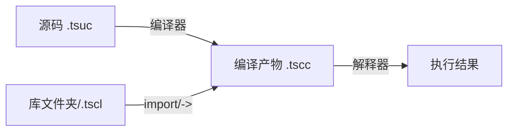

# 安装与使用

> 对标 [Python Using Python](https://docs.python.org/zh-cn/3.16/using/)
>
> Tanex Script 解释器的安装、配置、命令行使用、环境变量、REPL 等运行时使用指南。

---

## 章节导航

| 章节 | 说明 |
|------|------|
| [install.md](install.md) | 安装说明 |
| [cmdline.md](cmdline.md) | 命令行参数完整参考 |
| [envvars.md](envvars.md) | 环境变量 |
| [repl.md](repl.md) | REPL 交互模式详细指南 |
| [compilation.md](compilation.md) | 编译流程与产物 |

---

## 快速开始

### 获取解释器

```bash
# Windows 安装包(含解释器、标准库、示例)
# 下载：https://github.com/tanex-script/tanex-script/releases/latest/TanexScript_Setup.exe

# 或从源码构建(需 Python 3.10+)
git clone https://github.com/tanex-script/tanex-script.git
cd tanex-script/核心
pip install -r requirements.txt
python -m tanex --help
```

### 运行第一个程序

```bash
# 创建 hello.tsuc
echo '@ # Hello World #; import "standard" = *std; std.standard_output << "Hello, Tanex Script!\n";' > hello.tsuc

# 直接运行源码(内部自动编译)
python -m tanex run hello.tsuc
# =>
# Hello, Tanex Script!

# 或先编译再运行
python -m tanex compile hello.tsuc -o hello.tscc
python -m tanex run hello.tscc
```

---

## 文件后缀约定

| 后缀 | 含义 | 典型用途 |
|------|------|----------|
| `.tsuc` | Tanex Script Uncompiled Code | 源码文件，人类编写 |
| `.tscc` | Tanex Script Compiled Code | 编译产物 JSON AST，解释器直接加载执行 |
| `.tscl` | Tanex Script Compiled Library | 编译库二进制包，含多个 `.tscc` |
| 目录/ | Tanex Script 库文件夹 | 包含 `main.tsuc` 等的库源码目录 |

---

## 编译与运行流程



---

## 相关链接

- [教程：快速上手](../tutorial/intro.md) — 从零开始
- [语言参考：模块系统](../reference/modules.md) — import/->、路径解析
- [扩展与嵌入：Python API](../extending/) — 解释器嵌入、编译器调用
- [版本更新记录](../whatsnew/) — 1.0.0 基线、后续增量