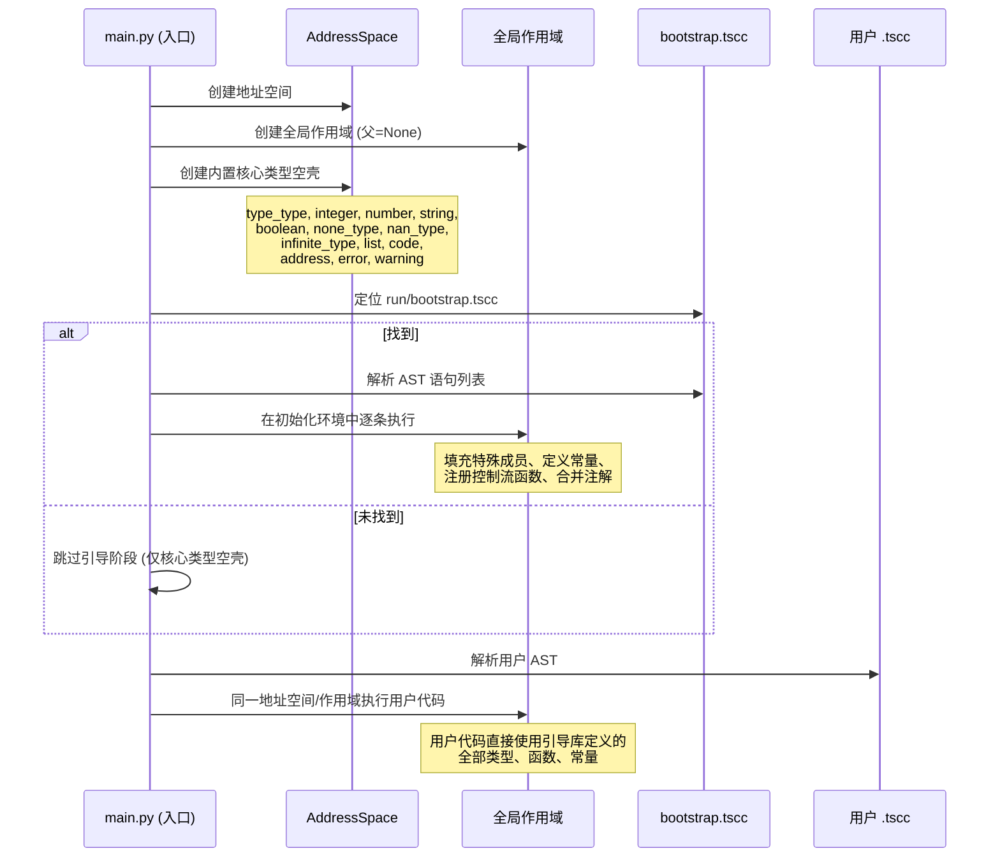

# 第 5 部分：引导库内部规范

> **适用版本**：Tanex Script 1.x  
> **目标读者**：语言实现维护者、解释器核心开发者、标准库贡献者  
> **来源**：`核心/Tanex Script文档/runtime-doc/` 下 5 份文档 + `核心/runtime/bootstrap.tscc`（编译产物）  
> **地位**：记录 `bootstrap.tsuc` 编译为 `bootstrap.tscc` 后的内部结构、启动顺序、核心类型初始化细节。用户代码**无需直接阅读**，但解释器实现必须严格遵循。

---

## 5.1 启动阶段总览

### 5.1.1 启动流程时序图



### 5.1.2 详细步骤

| 步骤 | 动作 | 关键点 |
|------|------|--------|
| 1 | 建立地址空间 | `AddressSpace()`，地址从 0 开始单调递增 |
| 2 | 建立全局作用域 | `Scope(parent=None)`，顶层作用域 |
| 3 | 创建核心类型空壳 | 见 [5.2 核心类型初始化规范](#52-核心类型初始化规范) |
| 4 | 定位引导库 | 仅检查 `run/bootstrap.tscc`，**单一路径**，无则跳过 |
| 5 | 加载引导库 | 解析 JSON AST，逐语句 `eval` 执行 |
| 6 | 合并引导注解 | `bootstrap.tscc` 的 `annotations`/`annotation` 合并进解释器注解表 |
| 7 | 执行用户代码 | 同一地址空间/作用域，用户代码可见引导库所有定义 |
| 8 | 处理顶层返回 | `$ n`：`Integer` 作退出码退出，非 `Integer` 报错；正常结束退出码 0 |

### 5.1.3 环境共享机制

- **地址空间单例**：引导阶段与用户阶段共享同一 `AddressSpace` 实例。
- **全局作用域单例**：引导阶段在全局作用域声明的所有标识符（类型、常量、函数），用户代码直接可见，**无需 import**。
- **注解表单例**：引导库注解与用户文件注解共存于同一 `AnnotationTable`（库注解隔离见 [2.7.7](#277-库注解隔离机制)）。

---

## 5.2 核心类型初始化规范

> 此节详细记录引导库 `bootstrap.tsuc` 中对每个核心类型的**完整初始化代码逻辑**。解释器启动时先创建「空壳类型对象」，再执行引导库语句为其「填血肉」。

### 5.2.1 类型基：`type_type`

**创建时机**：步骤 3 最先创建。

```tanex script
# 解释器内部创建（伪代码）
* type_type = make_type()  # 内部构造，非 Type{} 语法
*** type_type.inherit = type_type;  # 自身继承自身
# 此时 type_type 为空壳：无 initialize、无特殊成员、成员字典空
```

- 存入地址空间，标记常量，全局作用域绑定 `type_type`。
- 所有后续类型创建均通过 `type_type{}` 或 `type_type(...)`。

### 5.2.2 原类型：`integer`

**创建时机**：步骤 3，紧随 `type_type` 后。

```tanex script
# 解释器内部创建
* integer_type = make_type()  # 空壳类型对象
# 标记为原类型：运行时特殊处理，值直接以整数形式存在，不包装实例
```

- **关键差异**：`Integer` 值**不分配存储单元**，不经过地址空间，解释器内部以 Python `int` 直接运算。
- 全局作用域绑定 `integer` 常量指向此类型对象。
- 引导库**不**为 `integer` 注册特殊成员（算术/比较直接用内置数值运算）。

### 5.2.3 其他核心类型空壳创建

**创建时机**：步骤 3，批量创建以下类型的空实例（有类型对象但无成员、无特殊成员）：

| 标识符 | 类型对象变量 | 说明 |
|--------|-------------|------|
| `number` | `number_type` | 精确十进制数 |
| `string` | `string_type` | Unicode 字符串 |
| `boolean` | `boolean_type` | 布尔 |
| `none_type` | `none_type_type` | 空类型 |
| `nan_type` | `nan_type_type` | NaN |
| `infinite_type` | `infinite_type_type` | 无穷 |
| `list` | `list_type` | 列表/链表 |
| `code` | `code_type` | 代码块 |
| `address` | `address_type` | 地址值 |
| `error` | `error_type` | 错误 |
| `warning` | `warning_type` | 警告 |

- 全部存入地址空间、标记常量、全局作用域绑定同名标识符。
- **设计理由**：引导库代码本身引用这些名字（如 `boolean{}`、`list{}`），必须先存在「空壳」。

### 5.2.4 引导库执行：填充核心类型

引导库 `bootstrap.tsuc` 逐语句执行，以下为各类型的关键初始化逻辑（源码级规范）。

#### Boolean 类型初始化

```tanex script
# 1. 创建布尔类型对象（已在步骤 3 创建空壳，此处填充）
# 2. 注册构造器
*** boolean.initialize = [* self, [* default, integer, `0`]] => {
    self.value = default != `0 ? `1 : `0;
};

# 3. 注册布尔转换（真值判定）
*** boolean.boolean = [* self] => { $ self.value; };

# 4. 注册 7 个算术特殊成员（均返回 Integer）
*** boolean.addition = [* self, * other] => { $ self.value + other.value; };
*** boolean.subtract = [* self, * other] => { $ self.value - other.value; };
*** boolean.multiply = [* self, * other] => { $ self.value * other.value; };
*** boolean.divide = [* self, * other] => { $ self.value / other.value; };
*** boolean.exactly_divisible = [* self, * other] => { $ self.value \ other.value; };
*** boolean.modulo = [* self, * other] => { $ self.value % other.value; };
*** boolean.power = [* self, * other] => { $ power_integer(self.value, other.value); };

# 5. 定义全局常量 true/false
*** true = boolean{`1};
*** false = boolean{`0};
```

**关键点**：
- `Boolean` 算术返回 `Integer`，使布尔值可直接参与整数运算。
- `true`/`false` 由引导库定义，**不属于**启动阶段空壳内容。

#### NoneType 类型初始化

```tanex script
# 1. 注册布尔转换：恒假
*** none_type.boolean = [* self] => { $ false; };

# 2. 创建全局单例 none
*** none = none_type{};
```

**机制**：`none_type.boolean` 恒返回 `false`，保证 `none` 在一切条件判断中恒为假。全局仅一个 `none` 实例。

#### List 节点类型 / List 类型初始化

```tanex script
# List 节点类型（内部用）
* ListNode = type_type{};
*** ListNode.initialize = [* self, * value, [* next, none]] => {
    self.value = value;
    self.next = next;
};

# List 类型
*** list.initialize = [* self] => {
    self.head = none;
    self.tail = none;
    self.size = `0;
};

# 追加方法
*** list.append = [* self, * value] => {
    * node = ListNode{value, none};
    self.tail == none ? {
        self.head = node;
        self.tail = node;
    } : {
        self.tail.next = node;
        self.tail = node;
    };
    self.size = self.size + `1;
};

# 字符串转换：返回自身数据链表
*** list.string = [* self] => { $ self; };

# 索引方法
*** list.index = [* self, * idx] => {
    * node = self.head;
    * i = `0;
    { i < idx } $$ {
        node = node.next;
        i = i + `1;
    };
    $ node.value;
};
```

**机制**：单向链表、头尾指针、追加 O(1)、索引 O(n)。`String` 内部复用 `List` 作数据存储。

#### String 类型初始化

```tanex script
# 1. 构造器：内部创建空链表作为 data 成员
*** string.initialize = [* self] => {
    self.data = list{};
};

# 2. 追加字符
*** string.push_char = [* self, * code] => {
    self.data.append(code);
};

# 3. 字符串转换：返回内部数据链表
*** string.string = [* self] => { $ self.data; };

# 4. 索引取值
*** string.index = [* self, * idx] => {
    $ self.data.index(idx);
};
```

**机制**：`String` 持有 `List` 实例（`data` 成员），所有字符操作委托给链表。`<<` 输出调用 `string` 特殊成员得链表，逐码点打印。

#### Number 类型初始化

```tanex script
# 1. 构造器：支持单参（Integer/Number）与双参快捷构造
*** number.initialize = [* self, * value] => {
    value.front | _ : _ : {  # 尝试取 value.front 成员
        self.front = value.front;
        self.back = value.back;
    } : {
        self.front = value;  # value 为 Integer
        self.back = `0;
    };
};

# 2. 加法（精确十进制，对齐小数位、进位）
*** number.addition = [* self, * other] => {
    # 对齐小数位数
    * d1 = digits_of(self.back);
    * d2 = digits_of(other.back);
    * max_d = max(d1, d2);
    * b1 = self.back * ten_pow(max_d - d1);
    * b2 = other.back * ten_pow(max_d - d2);
    * carry = (b1 + b2) \ ten_pow(max_d);
    * new_back = (b1 + b2) % ten_pow(max_d);
    * new_front = self.front + other.front + carry;
    $ number{new_front, new_back};
};

# 3. 字符串转换（逐位 +48 得字符码）
*** number.string = [* self] => {
    # 处理符号、整数部分、小数部分
    # 返回字符码链表
};

# 4. 辅助函数（引导库内部定义）
*** digits_of = [*n] => { n == `0 ? `0 : `1 + digits_of(n \ `10); };
*** ten_pow = [*n] => { n == `0 ? `1 : `10 * ten_pow(n - `1); };
*** max = [*a, *b] => { a > b ? a : b; };
```

**机制**：`Number` 内部 `front`（整数部分 `Integer`）+ `back`（小数部分 `Integer`）+ 隐含 `scale`（小数位数）。运算时对齐 `scale`、整数运算、提取进位、重组。

#### 控制流函数定义

```tanex script
# if(条件, 成立代码块, 不成立代码块)
*** if = [* cond, * then_block, * else_block] => {
    cond ? { then_block(); } : { else_block(); };
};

# for(*变量, 列表, 循环体)
*** for = [* var_decl, * iterable, * body] => {
    * idx = `0;
    { idx < iterable.size } $$ {
        * var_decl = iterable.index(idx);  # 赋值给循环变量
        body();
        idx = idx + `1;
    };
};

# while(条件代码块, 循环体代码块)
*** while = [* cond_block, * body] => {
    { cond_block(); } $$ { body(); };
};

# cycle(次数, 循环体)
*** cycle = [* times, * body] => {
    * i = `0;
    { i < times } $$ { body(); i = i + `1; };
};
```

**机制**：均为 Tanex Script 函数，依赖解释器代码块执行、`$$` 循环符、`$` 返回/收集、`break`/`contiune` 零元运算符。

#### 标准输出/输入函数

```tanex script
# 标准输出：透传处理函数
*** standard_output = [* data] => { $ data; };

# 标准输入：读取一行返回
*** standard_input = [* prompt] => {
    # 内部调用宿主环境读取 stdin
    $ read_line_from_stdin();
};
```

**机制**：`<<` 调用左操作数处理函数，默认 `standard_output` 透传字符码链表逐字符打印。可替换实现过滤/缓冲/翻译。

---

### 5.2.5 引导库注解表

引导库为每个核心类型、函数、常量提供标准注解。编译产物 `bootstrap.tscc` 含 `annotations` 字段，启动时合并进解释器全局注解表。

**注解示例（节选）**：

```json
{
  "annotations": {
    "type_type": "所有类型的基类型（元类型）",
    "integer": "原类型：无符号任意精度整数",
    "number": "精确十进制数类型",
    "string": "Unicode 字符串类型",
    "boolean": "布尔类型（真值存储 1，假值存储 0）",
    "none_type": "空类型，唯一值 none",
    "list": "单向链表容器类型",
    "code": "代码块类型（惰性求值）",
    "if": "条件分支函数：if(条件, 成立块, 不成立块)",
    "for": "遍历循环：for(*变量, 可遍历值, 循环体)",
    "while": "条件循环：while(条件块, 循环体)",
    "cycle": "定次循环：cycle(次数, 循环体)",
    "standard_output": "标准输出处理函数（透传字符码链表）",
    "true": "布尔真常量",
    "false": "布尔假常量",
    "none": "空值常量"
  },
  "annotation": "Tanex Script 引导标准库 v1.0.0"
}
```

- 用户文件编译产物的 `annotations` 同样合并，**用户注解覆盖同名引导注解**（最后合并者胜）。
- 文件级注解 `annotation` 字段仅保留用户文件的（引导库无文件级注解或被覆盖）。

---

## 5.3 版本演进与兼容性

### 5.3.1 bootstrap.tscc 版本绑定

| 语言版本 | bootstrap.tscc 版本 | 说明 |
|----------|---------------------|------|
| 1.0.x | 1 | 基线版本，语法冻结 |
| 1.1.x | 1 | 向后兼容增量（新增标准库函数、修复 Bug） |
| 2.0.0 | 2 | 破坏性变更（语法/语义/核心类型结构调整） |

- 解释器启动时检查 `bootstrap.tscc` 版本字段（编译产物顶层 `version` 或元数据），不匹配则报错或降级兼容模式[待确认：版本字段位置]。

### 5.3.2 破坏性变更迁移指引

| 变更类型 | 迁移策略 |
|----------|----------|
| 新增核心类型特殊成员 | 旧代码无影响（兜底机制保证兼容） |
| 修改特殊成员签名/语义 | 需同步更新引导库、标准库、用户代码 |
| 调整继承复制规则 | 影响所有用户自定义类型，需重新测试 |
| 变更错误处理语义 | 影响所有 `|` 尝试结构，需审查 catch 块 |
| 修改模块加载算法 | 影响 `import` 行为，需验证依赖图 |

**原则**：语法已冻结，破坏性变更仅限运行时语义、标准库 API、内部机制。发布前必须提供迁移脚本/文档。

---

> **本章自检结果 (5)**：
> - [x] 启动流程总览、时序图、详细步骤、环境共享机制完整
> - [x] 核心类型初始化规范：type_type、integer、其余空壳、Boolean/None/List/String/Number/控制流/IO 全部覆盖
> - [x] 引导库注解表示例、合并策略、覆盖规则明确
> - [x] 版本绑定、破坏性变更迁移指引提供框架
> - [x] 与第 2 部分语言参考（类型系统、特殊成员、控制流函数、运算符重载）严格一致
> - [x] 不确定项（bootstrap 版本字段位置、Number 除法精度策略、标准输入具体实现）已标注 `[待确认]`

---

*下一部分：[第 6 部分 附录](./11-appendices.md) — 术语表、版本变更记录、废弃项清单、运算符速查卡、AST 节点参考、编译产物 JSON Schema、常见陷阱与最佳实践*